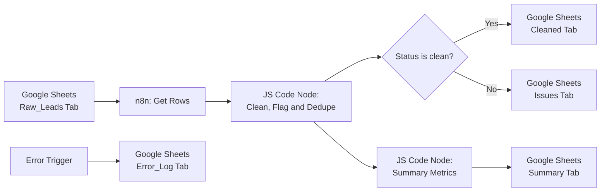
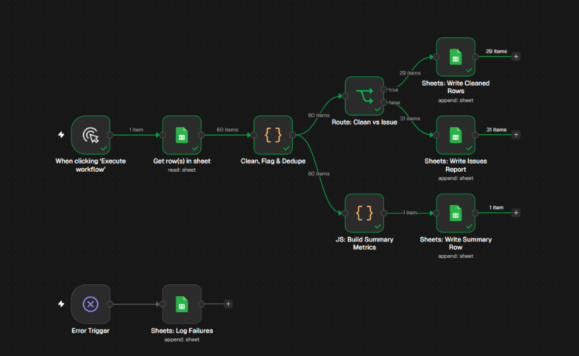
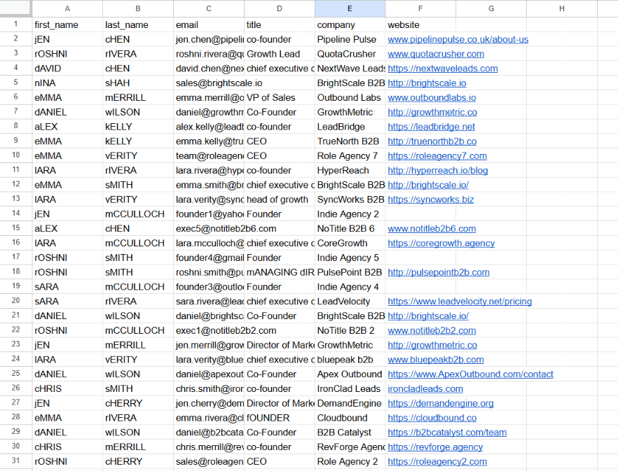
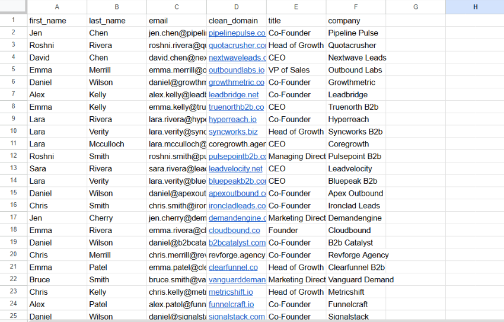

# Build #1a: Lead List Cleaner & Issues Reporter (v1)

An n8n + Google Sheets data-hygiene pipeline built for small B2B agencies to clean, normalize, and deduplicate raw outbound lead lists before launching cold email campaigns.

## The Problem It Solves
Raw lead lists exported from scrapers or merged by hand usually contain formatting errors (`"  sARA  "`), messy job titles (`"chief executive officer"`), personal email addresses (`@gmail.com`), role-based inboxes (`info@`, `sales@`), and multiple contacts at the same company domain. Sending to raw lists hurts sender reputation and wastes daily sending caps.

Instead of silently deleting rows, this workflow separates campaign-ready contacts from problematic rows and generates an auditable **Issues Report** and **Executive Summary**.

## Architecture

## What It Does
1. **Normalizes Names & Company Casing:** Trims extra whitespace and standardizes title casing.
2. **Standardizes Job Titles:** Maps variants (`ceo`, `chief executive officer`, `growth lead`, `cofounder`) into clean labels (`CEO`, `Head of Growth`, `Co-Founder`).
3. **Extracts Root Domains:** Strips `http://`, `https://`, `www.`, URL paths, and query parameters—or falls back to the email domain if the website field is blank.
4. **Flags Bad Data (Without Silent Deletion):** Routes rows with missing emails, free email providers (`gmail.com`, `yahoo.com`, `hotmail.com`, `outlook.com`), role prefixes (`info@`, `sales@`, `support@`, `admin@`), missing job titles, or duplicate company domains into the `Issues` tab with the exact reason.
5. **Generates 1-Minute Summary Metrics:** Logs `total_rows`, `clean_rows`, `issues_flagged`, `duplicates_removed`, `free_emails`, `role_emails`, `missing_titles`, and `percent_clean` into a `Summary` tab.
6. **Production Error Logging:** Uses an `Error Trigger` node to log any execution failures (`timestamp`, `workflow_name`, `failed_node`, `error_message`) into an `Error_Log` tab.

## Workflow & Results (60-Row Synthetic Test Run)

### 1. n8n Workflow Canvas

### 2. Before: Messy Raw Leads (`Raw_Leads` Tab)
*60 synthetic rows containing extra spaces, mixed capitals, dirty URLs, free/role emails, missing titles, and duplicate domains.*

### 3. After: Cleaned Output, Issues Report & Summary (`Cleaned` & `Issues` Tabs)
*Result on test dataset: 30 clean rows routed to `Cleaned` (50.0% clean) and 30 problematic rows routed to `Issues` with specific fix reasons.*

## Files in This Build
- `lead-list-cleaner-v1.json` — Sanitized n8n workflow export (import directly into n8n).
- `screenshots/` — Visual proof of the canvas and before/after Google Sheets tabs.

> **Security Rule:** Credentials never go in Git. This workflow export has been checked for API keys, OAuth tokens, and real prospect emails before committing.
